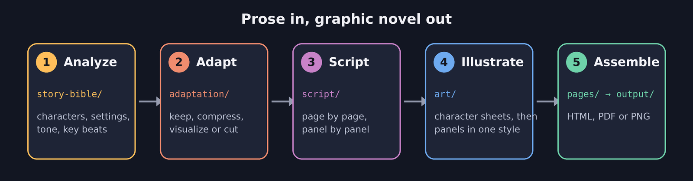
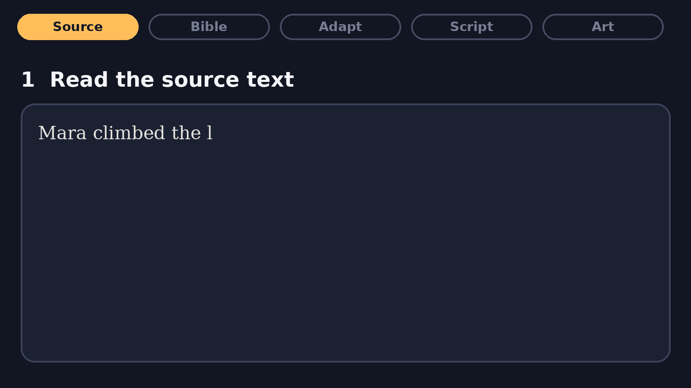
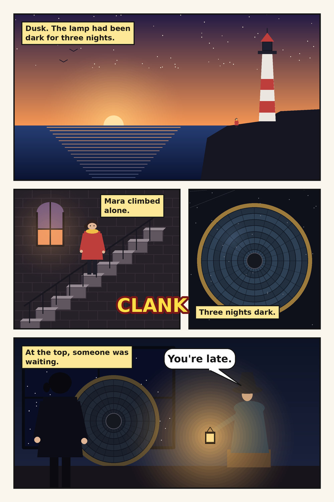
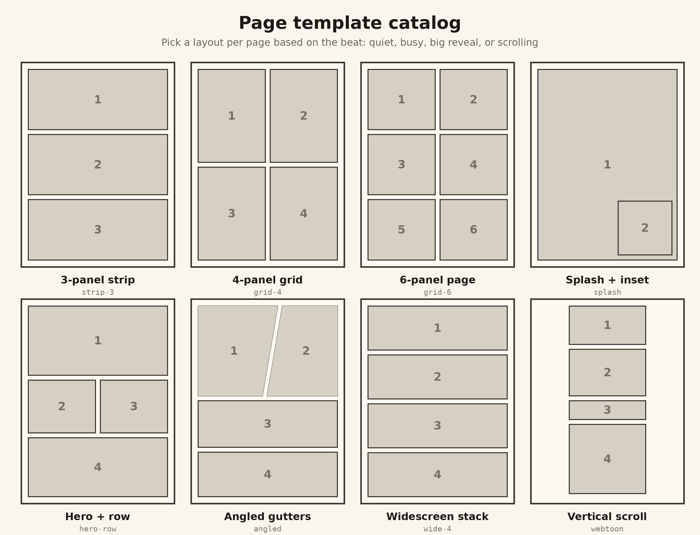
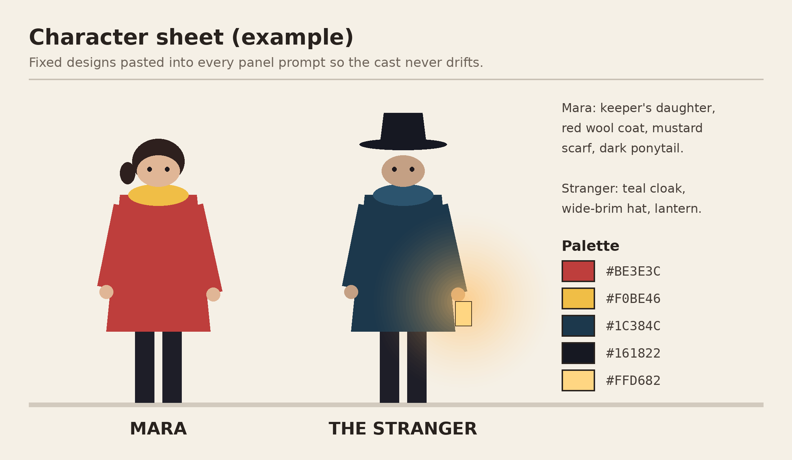
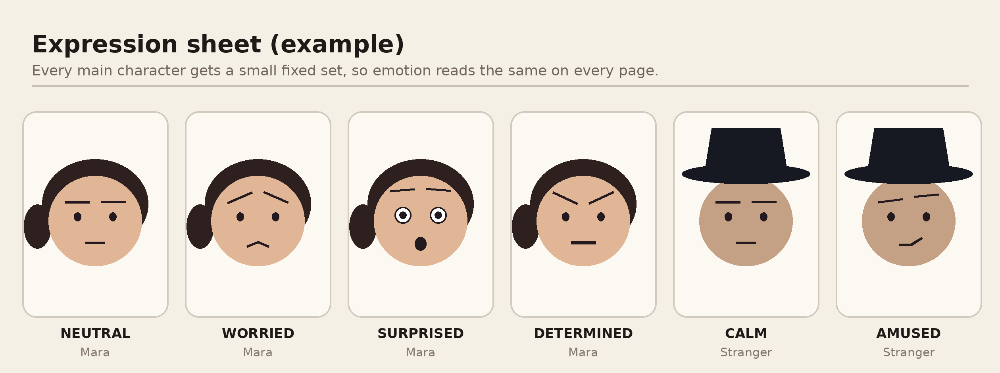

# Graphic Novel AI Agent

Turn a story or novel excerpt into a finished graphic novel. Give the agent prose; it returns comic pages with consistent characters, a fixed art style, lettered panels and a shareable export.



## Contents

- [See it in action](#see-it-in-action)
- [What it does](#what-it-does)
- [Define your book's persona](#define-your-books-persona)
- [How each stage works](#how-each-stage-works)
- [Example: one beat, start to finish](#example-one-beat-start-to-finish)
- [Page templates](#page-templates)
- [Character design](#character-design)
- [Quick start](#quick-start)
- [Folder structure](#folder-structure)
- [Design principles](#design-principles)

> **About the images.** All pictures and animations in this README are illustrative mockups of the workflow, drawn by a script from a short invented story ("Mara and the dark lighthouse"). They show the format and the stages, not the output quality of any particular image model. Real artwork depends on the image generator you connect.

## See it in action

### The five stages, end to end

The animation below follows one short passage through every stage: source text, story bible, adaptation plan, panel script, and finished page.



### Building a page

Panels are laid out first, then lettering (captions, sound effects, speech balloons) is added on top so text never has to be baked into the artwork.


### A finished page



## What it does

| You provide | The agent produces |
|---|---|
| A story, chapter or novel excerpt in `source/` | A **story bible**: characters, settings, tone, key beats |
| | An **adaptation plan**: what to keep, compress, visualize or cut, with a page budget |
| | A **page-by-page, panel-by-panel script**: shot types, action, dialogue, captions, SFX |
| | **Panel artwork** in one consistent style, built from character reference sheets |
| | **Assembled pages** exported as HTML, PDF or PNG |

The rules every stage follows live in `reference/` (art style, panel layout conventions, script format), so the first page and the last page look like they belong to the same book.

## Define your book's persona

Before anything is analyzed or drawn, you describe the book you want in `persona/persona.md`. The agent reads it first and every stage follows it.

| Field group | What you set | Which stage uses it |
|---|---|---|
| Identity | genre, tone and mood, themes | story bible, adaptation |
| Audience | reader age, content rating | adaptation (what to soften or cut), script |
| Voice | caption narration, dialogue style, language, humor | script |
| Look and feel | art style in words, palette mood, lettering style | illustration (feeds `reference/art-style.md`) |
| Structure | length, pacing, panels per page, format, favored layouts | adaptation, script, assembly |
| Cast hints | protagonist persona, other characters | story bible, character sheets |
| Guardrails | must keep, must avoid | every stage |

Leave a field blank and the agent picks a sensible default and tells you what it chose.

**Start from a preset.** Copy a file from `persona/presets/` over `persona/persona.md` and edit it:

| Preset | Feel |
|---|---|
| `noir-thriller.md` | high-contrast ink, first-person captions, slow burn |
| `whimsical-childrens.md` | soft watercolor, simple words, spacious pages |
| `manga-action.md` | black and white screentone, speed lines, fast panels |
| `mythic-epic.md` | painterly, ornamental, jewel tones with gold |

**Or describe it in a sentence.** For example: "A cozy mystery for teens, warm autumn colors, light humor, about 20 pages." The agent turns that into the persona file and asks about anything it can't guess.

## How each stage works

**1. Analyze** (`story-bible/`)
Reads the source and records who is in it, where it happens, how it should feel and the beats in story order. Character designs are fixed here, before any art exists.

**2. Adapt** (`adaptation/`)
Prose and comics spend their time differently. Every beat is marked:

| Decision | Meaning |
|---|---|
| Keep | Works as written; becomes a panel or page |
| Compress | Needs fewer panels than words (travel, repetition) |
| Visualize | Interior thought or description turned into an image |
| Cut | Doesn't earn its page space; the agent asks before cutting anything important |

**3. Script** (`script/page-NN.md`)
One file per page. Each panel states its shot type, setting, action, caption, dialogue and sound effect. Only things that can be drawn are described. Full format in `reference/script-format.md`.

**4. Illustrate** (`art/`)
Character sheets come first. Every panel prompt then reuses the same style prompt and the same fixed character descriptions.

**5. Assemble** (`pages/`, `output/`)
Panels are laid into pages following `reference/panel-layout.md` (pacing, gutters, reading order, page-turn hooks), lettered, and exported.

## Example: one beat, start to finish

**Source text**

> At the top, a stranger sat beside the lens, holding a small glowing lantern. "You're late," he said.

**Adaptation decision:** Keep, one wide panel for the reveal, lantern as the light source.

**Script**

```
## Panel 4
Shot: medium, warm lantern light
Setting: lamp room at the top of the lighthouse, night
Action: The Stranger sits beside the dead lens, lantern raised.
        Mara, seen from behind in the foreground.
Caption: "At the top, someone was waiting."
Dialogue:
  STRANGER: "You're late."
SFX: none
```

**Result:** the bottom panel of the sample page above.

## Page templates

`reference/panel-templates.md` holds a catalog of page layouts, loosely modeled on common comic-strip and comic-page conventions: 3-panel strips, 4- and 6-panel grids, splash pages, angled gutters, widescreen stacks and vertical-scroll layouts. Each page script names its layout (`Layout: hero-row`), and the agent picks layouts to match the beat: fewer, larger panels for quiet moments; more, smaller, angled panels for action; a splash for the big reveal.



The catalog also lists panel shapes (rectangular, angled, borderless) and lettering elements (speech balloon, thought cloud, shout, whisper, caption box, SFX).

## Character design

`reference/character-design.md` gives a one-page template for every main character: silhouette, shape language, face, hair, costume, signature item, a 3-to-5 color palette with hex codes, a fixed expression set and a one-sentence prompt snippet. The agent writes this once in the story bible, then pastes the same description into every panel prompt so faces, outfits and colors never drift.



Each character also gets a small fixed set of expressions, so emotion reads the same on every page.



## Quick start

1. Put your story in `source/` (plain text or Markdown).
2. Define your book in `persona/persona.md`, or copy a preset from `persona/presets/`.
3. Fill in `reference/art-style.md`: the style prompt, palette and lettering choices. The agent can draft this from your persona.
4. Open this folder in Claude and ask, for example:
   > Adapt `source/story.md` into a 12-page graphic novel using my persona. Start with the story bible and adaptation plan and show them to me before scripting.
5. Review each stage's output before the next one starts. The agent follows the instructions in `CLAUDE.md`.
6. Find finished pages in `output/`.

## Folder structure

```
graphic-novel-ai-agent/
├── CLAUDE.md          agent instructions and workflow
├── README.md
├── persona/           persona.md (your book's brief) and presets/
├── reference/         art-style.md, panel-layout.md, panel-templates.md,
│                      character-design.md, script-format.md
├── source/            input story or excerpt
├── story-bible/       stage 1 output (template included)
├── adaptation/        stage 2 output (template included)
├── script/            stage 3 output, one file per page (template included)
├── art/
│   ├── characters/    character reference sheets
│   └── panels/        panel artwork
├── pages/             assembled pages
├── output/            final HTML / PDF / PNG
└── docs/images/       images used in this README
```

## Design principles

- **Show, don't narrate.** Prefer a picture over a caption; keep captions short.
- **Stay faithful.** Dialogue may be trimmed and rephrased, but the plot and meaning are not invented or changed.
- **Your book, your voice.** The persona file sets genre, tone, audience and look before any work starts.
- **One style, one cast.** Style prompt and character descriptions never change mid-book.
- **Review between stages.** Each stage is checked against the one before it, and key cuts are confirmed with you.
- **Mind the source.** For stories that aren't yours, keep adaptations to personal use and avoid reproducing long passages verbatim.

## License

Released under the [MIT License](LICENSE). You can use, copy, change and share it freely, including in commercial projects, as long as you keep the copyright and license notice.
